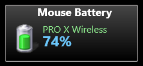

# Rainmeter Logitech Battery

A compact Rainmeter widget for Logitech mouse battery percentage and charging status, powered by [Logitray](https://github.com/voji/logitray).



## Features

- Battery percentage and level icon.
- A yellow lightning bolt over the battery icon while charging.
- Automatic polling every 15 minutes after a valid reading.
- Retries every 30 seconds while the mouse is unavailable.
- Middle-click or use the context menu to refresh immediately.
- USB receiver and direct USB cable connections, when supported by the installed Logitray build.

## Requirements

- Windows with [Rainmeter](https://www.rainmeter.net/) installed. The RunCommand plugin is included with Rainmeter.
- A compatible Logitech HID++ device. Tested with PRO X Wireless.
- A Logitray build providing `--once` output such as `PRO X Wireless: 74%` or `PRO X Wireless: 74% (charging)`.

Direct USB battery monitoring requires a Logitray build containing the [direct USB support changes](https://github.com/voji/logitray/tree/feat/direct-usb-battery). The widget does not bundle Logitray or assume that every release supports this feature.

## Installation

1. Download this repository and copy the entire `LogitechBattery` folder into your Rainmeter skins folder, usually `%USERPROFILE%\Documents\Rainmeter\Skins`. For redirected Documents folders, use the skins location configured in Rainmeter.
2. Place your compatible `logitray.exe` at `C:\Programs\logitray.exe`, or set `LogitrayPath` to its location.
3. Edit `LogitechBattery/Mouse Battery.ini` and set `DeviceName` to the exact device name printed by `logitray.exe --once`.
4. In Rainmeter, refresh the skin list and load `LogitechBattery\Mouse Battery.ini`.

This skin includes its own visual resources; the Gadgets suite is not required.

## Configuration

Edit the `[Variables]` section of `Mouse Battery.ini`, then refresh the skin:

```ini
RefreshSeconds=900
RetrySeconds=30
Scale=1.50
LogitrayPath=C:\Programs\logitray.exe
DeviceName=PRO X Wireless
```

| Setting | Meaning |
| --- | --- |
| `RefreshSeconds` | Seconds between polls after a valid measurement; default 900 (15 minutes). |
| `RetrySeconds` | Retry interval when no valid measurement is available; default 30 seconds. |
| `Scale` | Display scale; default 1.50 (150%). |
| `LogitrayPath` | Full path to the Logitray executable. |
| `DeviceName` | Exact device name to read from Logitray output. |

If a later measurement fails, polling returns to the retry interval. Charging state is refreshed when a poll completes; it is not an instant USB connection notification.

## Troubleshooting

- If the widget shows `--%`, run Logitray with `--once` and check the device name, connection, and installed build.
- `LastOutput.txt` and `LastReading.txt` in the skin folder contain the most recent command output and parsed result. These local diagnostic files are excluded from Git.
- For a cabled mouse, use a build with direct USB support and a device that exposes battery data over USB.

## Credits and license

The battery sprite and gadget styling are adapted from [Gadgets by SilverAzide](https://github.com/SilverAzide/Gadgets), whose installed skin metadata specifies Creative Commons Attribution-NonCommercial-ShareAlike 4.0. The polling logic, Logitray integration, and charging overlay were adapted for this standalone skin by voji.

This skin is distributed under [CC BY-NC-SA 4.0](https://creativecommons.org/licenses/by-nc-sa/4.0/). See [LICENSE](LICENSE). Logitray is a separate project with its own license.
